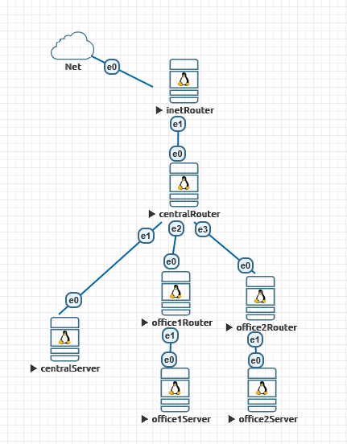
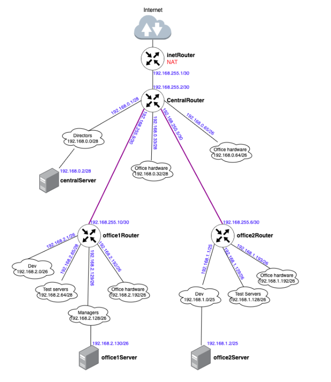

# Домашнее задание
## Архитектура сетей

### Цель:

Научиться менять базовые сетевые настройки в Linux-based системах   

### Дано



### Планируемая архитектура

Сеть office1

    192.168.2.0/26 - dev
    192.168.2.64/26 - test servers
    192.168.2.128/26 - managers
    192.168.2.192/26 - office hardware

Сеть office2

    192.168.1.0/25 - dev
    192.168.1.128/26 - test servers
    192.168.1.192/26 - office hardware

Сеть central

    192.168.0.0/28 - directors
    192.168.0.32/28 - office hardware
    192.168.0.64/26 - wifi

🎯Задание 

Теоретическая часть

* Найти свободные подсети
* Посчитать сколько узлов в каждой подсети, включая свободные
* Указать broadcast адрес для каждой подсети
* проверить нет ли ошибок при разбиении


Практическая часть

* Соединить офисы в сеть согласно схеме и настроить роутинг
* Все сервера и роутеры должны ходить в инет черз inetRouter
* Все сервера должны видеть друг друга


### 1. Теоретическая часть

Первым шагом мы рассмотрим все сети, указанные в задании. Посчитаем для них количество узлов, найдём Broadcast-адрес, проверим, нет ли ошибок при разбиении.   


<table>
  <thead>
    <tr>
      <th>Name</th>
      <th>Network</th>
      <th>Netmask</th>
      <th>N</th>
      <th>Hostmin</th>
      <th>Hostmax</th>
      <th>Broadcast</th>
    </tr>
  </thead>
  <tbody>
    <tr>
      <th colspan="7">Central Network</th>
    </tr>
    <tr>
      <td>Directors</td>
      <td>192.168.0.0/28</td>
      <td>255.255.255.240</td>
      <td>14</td>
      <td>192.168.0.1</td>
      <td>192.168.0.14</td>
      <td>192.168.0.15</td>
    </tr>
    <tr>
      <td>Office hardware</td>
      <td>192.168.0.32/28</td>
      <td>255.255.255.240</td>
      <td>14</td>
      <td>192.168.0.33</td>
      <td>192.168.0.46</td>
      <td>192.168.0.47</td>
    </tr>
    <tr>
      <td>Wifi(mgt network)</td>
      <td>192.168.0.64/26</td>
      <td>255.255.255.192</td>
      <td>62</td>
      <td>192.168.0.65</td>
      <td>192.168.0.126</td>
      <td>192.168.0.127</td>
    </tr>
    <tr>
      <th colspan="7">Office 1 network</th>
    </tr>
    <tr>
      <td>Dev</td>
      <td>192.168.2.0/26</td>
      <td>255.255.255.192</td>
      <td>62</td>
      <td>192.168.2.1</td>
      <td>192.168.2.62</td>
      <td>192.168.2.63</td>
    </tr>
    <tr>
      <td>Test</td>
      <td>192.168.2.64/26</td>
      <td>255.255.255.192</td>
      <td>62</td>
      <td>192.168.2.65</td>
      <td>192.168.2.126</td>
      <td>192.168.2.127</td>
    </tr>
    <tr>
      <td>Managers</td>
      <td>192.168.2.128/26</td>
      <td>255.255.255.192</td>
      <td>62</td>
      <td>192.168.2.129</td>
      <td>192.168.2.190</td>
      <td>192.168.2.191</td>
    </tr>
    <tr>
      <td>Office hardware</td>
      <td>192.168.2.192/26</td>
      <td>255.255.255.192</td>
      <td>62</td>
      <td>192.168.2.193</td>
      <td>192.168.2.254</td>
      <td>192.168.2.255</td>
    </tr>
    <tr>
      <th colspan="7">Office 2 network</th>
    </tr>
    <tr>
      <td>Dev</td>
      <td>192.168.1.0/25</td>
      <td>255.255.255.128</td>
      <td>126</td>
      <td>192.168.1.1</td>
      <td>192.168.1.126</td>
      <td>192.168.1.127</td>
    </tr>
    <tr>
      <td>Test</td>
      <td>192.168.1.128/26</td>
      <td>255.255.255.192</td>
      <td>62</td>
      <td>192.168.1.129</td>
      <td>192.168.1.190</td>
      <td>192.168.1.191</td>
    </tr>
    <tr>
      <td>Office</td>
      <td>192.168.1.192/26</td>
      <td>255.255.255.192</td>
      <td>62</td>
      <td>192.168.1.193</td>
      <td>192.168.1.254</td>
      <td>192.168.1.255</td>
    </tr>
    <tr>
      <th colspan="7">InetRouter — CentralRouter network</th>
    </tr>
    <tr>
      <td>Inet — central</td>
      <td>192.168.255.0/30</td>
      <td>255.255.255.252</td>
      <td>2</td>
      <td>192.168.255.1</td>
      <td>192.168.255.2</td>
      <td>192.168.255.3</td>
    </tr>
  </tbody>
</table>


После создания таблицы топологии, мы видим, что ошибок в задании нет, также мы сразу видим следующие свободные сети: 

* 192.168.0.16/28 
* 192.168.0.48/28
* 192.168.0.128/25
* 192.168.255.64/26
* 192.168.255.32/27
* 192.168.255.16/28
* 192.168.255.8/29  
* 192.168.255.4/30 


### 2. Практическая часть


Изучив таблицу топологии сети, мы можем построить полную схему сети:



На схеме, мы сразу можем увидеть, что нам потребуется создать дополнительно 2 сети (на схеме обозначены полужирными фиолетовыми линиями):
* Для соединения office1Router c centralRouter 
* Для соединения office2Router c centralRouter 

На основании этой схемы мы получаем готовый список серверов.   


<table>
  <thead>
    <tr>
      <th>Server</th>
      <th>IP and Bitmask</th>
    </tr>
  </thead>
  <tbody>
    <tr>
      <td rowspan="2">inetRouter</td>
      <td>Default-NAT address VirtualBox</td>
    </tr>
    <tr>
      <td>192.168.255.1/30</td>
    </tr>
    <tr>
      <td rowspan="6">centralRouter</td>
      <td>192.168.255.2/30</td>
    </tr>
    <tr>
      <td>192.168.0.1/28</td>
    </tr>
    <tr>
      <td>192.168.0.33/28</td>
    </tr>
    <tr>
      <td>192.168.0.65/26</td>
    </tr>
    <tr>
      <td>192.168.255.9/30</td>
    </tr>
    <tr>
      <td>192.168.255.5/30</td>
    </tr>
    <tr>
      <td>centralServer</td>
      <td>192.168.0.2/28</td>
    </tr>
    <tr>
      <td rowspan="5">office1Router</td>
      <td>192.168.255.10/30</td>
    </tr>
    <tr>
      <td>192.168.2.1/26</td>
    </tr>
    <tr>
      <td>192.168.2.65/26</td>
    </tr>
    <tr>
      <td>192.168.2.129/26</td>
    </tr>
    <tr>
      <td>192.168.2.193/26</td>
    </tr>
    <tr>
      <td>office1Server</td>
      <td>192.168.2.130/26</td>
    </tr>
    <tr>
      <td rowspan="4">office2Router</td>
      <td>192.168.255.6/30</td>
    </tr>
    <tr>
      <td>192.168.1.1/26</td>
    </tr>
    <tr>
      <td>192.168.1.129/26</td>
    </tr>
    <tr>
      <td>192.168.1.193/26</td>
    </tr>
    <tr>
      <td>office2Server</td>
      <td>192.168.1.2/26</td>
    </tr>
  </tbody>
</table>


### Настройка NAT
Для того, чтобы на всех серверах работал интернет, на сервере inetRouter должен быть настроен NAT.

```
root@inetRouter:~# iptables -t nat -A POSTROUTING ! -d 192.168.0.0/16 -o eth0 -j MASQUERADE
```

Создаём файл /etc/iptables_rules.ipv4:
```
# Generated by iptables-save v1.8.10 (nf_tables) on Mon Nov 16 15:46:08 2026
*nat
:PREROUTING ACCEPT [0:0]
:INPUT ACCEPT [0:0]
:OUTPUT ACCEPT [0:0]
:POSTROUTING ACCEPT [373:26480]
-A POSTROUTING ! -d 192.168.0.0/16 -o ens3 -j MASQUERADE
COMMIT
# Completed on Mon Nov 16 15:46:08 2026
```

Создаём файл, в который добавим скрипт автоматического восстановления правил при перезапуске системы:
```
vi /etc/network/if-pre-up.d/iptables

#!/bin/sh
/sbin/iptables-restore < /etc/iptables_rules.ipv4

```

Добавляем права на выполнение файла /etc/network/if-pre-up.d/iptables
```
root@inetRouter:~# sudo chmod +x /etc/network/if-pre-up.d/iptables
```

### Маршрутизация транзитных пакетов (IP forward)   

Важным этапом настройки сетевой лаборатории, является маршрутизация транзитных пакетов. Если объяснить простыми словами — это возможность сервера Linux пропускать трафик через себя к другому серверу. По умолчанию эта функция отключена в Linux. Включить её можно командой:
```
root@centralRouter:~# sudo sysctl -w net.ipv4.ip_forward=1
net.ipv4.ip_forward = 1
```
Необходимо включить данную маршрутизацию на всех роутерах.   


### Настройка статических маршрутов

Настройки добавил в отдельный файлах.

### Проверка:
```
root@centralServers:~# ip a
1: lo: <LOOPBACK,UP,LOWER_UP> mtu 65536 qdisc noqueue state UNKNOWN group default qlen 1000
    link/loopback 00:00:00:00:00:00 brd 00:00:00:00:00:00
    inet 127.0.0.1/8 scope host lo
       valid_lft forever preferred_lft forever
    inet6 ::1/128 scope host noprefixroute 
       valid_lft forever preferred_lft forever
2: ens3: <BROADCAST,MULTICAST,UP,LOWER_UP> mtu 1500 qdisc pfifo_fast state UP group default qlen 1000
    link/ether 00:50:00:00:3c:00 brd ff:ff:ff:ff:ff:ff
    altname enp0s3
    inet 192.168.0.2/28 brd 192.168.0.15 scope global ens3
       valid_lft forever preferred_lft forever
    inet6 fe80::250:ff:fe00:3c00/64 scope link 
       valid_lft forever preferred_lft forever
3: ens4: <BROADCAST,MULTICAST> mtu 1500 qdisc noop state DOWN group default qlen 1000
    link/ether 00:50:00:00:3c:01 brd ff:ff:ff:ff:ff:ff
    altname enp0s4
root@centralServers:~# ping 192.168.1.2
PING 192.168.1.2 (192.168.1.2) 56(84) bytes of data.
64 bytes from 192.168.1.2: icmp_seq=1 ttl=62 time=1.83 ms
64 bytes from 192.168.1.2: icmp_seq=2 ttl=62 time=1.86 ms
64 bytes from 192.168.1.2: icmp_seq=3 ttl=62 time=1.89 ms
64 bytes from 192.168.1.2: icmp_seq=4 ttl=62 time=1.81 ms
^C
--- 192.168.1.2 ping statistics ---
4 packets transmitted, 4 received, 0% packet loss, time 3004ms
rtt min/avg/max/mdev = 1.813/1.846/1.886/0.028 ms
root@centralServers:~# traceroute 192.168.1.2
traceroute to 192.168.1.2 (192.168.1.2), 30 hops max, 60 byte packets
 1  _gateway (192.168.0.1)  0.554 ms  0.361 ms  0.278 ms
 2  192.168.255.6 (192.168.255.6)  1.127 ms  1.057 ms  0.991 ms
 3  192.168.1.2 (192.168.1.2)  1.660 ms  1.489 ms  1.418 ms
root@centralServers:~# ping 192.168.2.130
PING 192.168.2.130 (192.168.2.130) 56(84) bytes of data.
64 bytes from 192.168.2.130: icmp_seq=1 ttl=62 time=1.75 ms
64 bytes from 192.168.2.130: icmp_seq=2 ttl=62 time=1.65 ms
64 bytes from 192.168.2.130: icmp_seq=3 ttl=62 time=2.09 ms
64 bytes from 192.168.2.130: icmp_seq=4 ttl=62 time=2.12 ms
^C
--- 192.168.2.130 ping statistics ---
4 packets transmitted, 4 received, 0% packet loss, time 3006ms
rtt min/avg/max/mdev = 1.654/1.902/2.116/0.203 ms
root@centralServers:~# traceroute 192.168.2.130
traceroute to 192.168.2.130 (192.168.2.130), 30 hops max, 60 byte packets
 1  _gateway (192.168.0.1)  0.350 ms  0.268 ms  0.219 ms
 2  192.168.255.10 (192.168.255.10)  1.084 ms  1.008 ms  0.783 ms
 3  192.168.2.130 (192.168.2.130)  1.346 ms  1.285 ms  1.225 ms
root@centralServers:~# 
```


