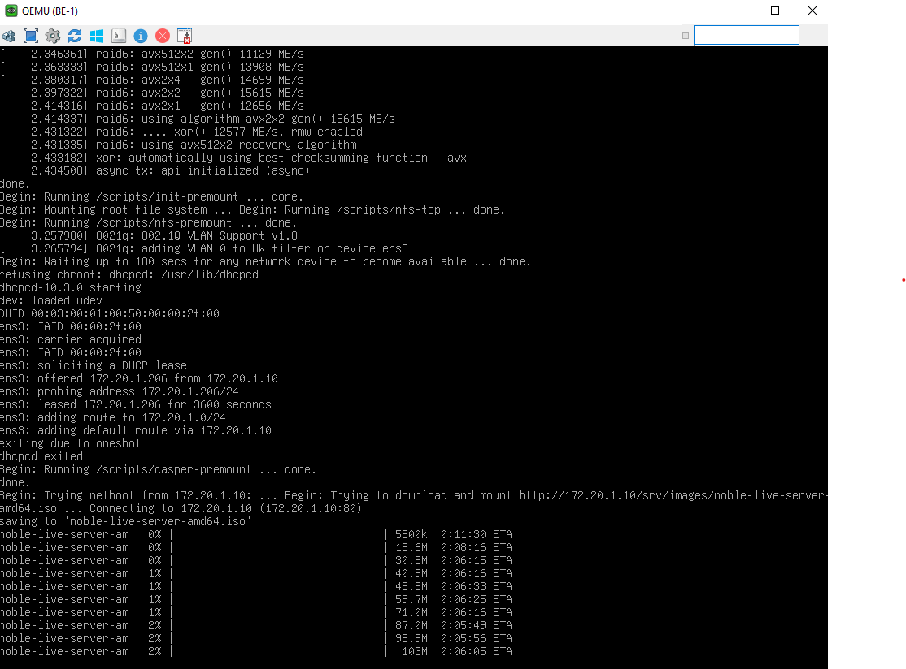
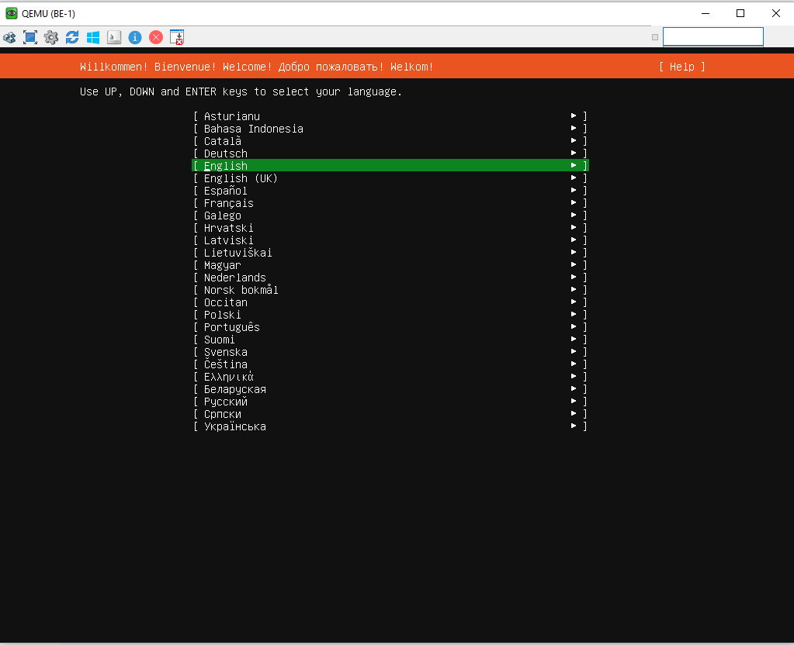

# Домашнее задание
## Настройка PXE сервера для автоматической установки

🎯Задание   
1. Настроить загрузку по сети дистрибутива Ubuntu 24
2. Установка должна проходить из HTTP-репозитория.
3. Настроить автоматическую установку c помощью файла user-data


### Настройка DHCP и TFTP-сервера
Для того, чтобы наш клиент мог получить ip-адрес нам требуется DHCP-сервер, чтобы можно было получить
файл pxelinux.0 нам потребуется TFTP-сервер. Утилита dnsmasq совмещает в себе сразу и DHCP и TFTP-
сервер.

1) отключаем firewall:
```
root@ubuntu:~# systemctl stop ufw
root@ubuntu:~# systemctl disable ufw
Synchronizing state of ufw.service with SysV service script with /usr/lib/systemd/systemd-sysv-install.
Executing: /usr/lib/systemd/systemd-sysv-install disable ufw
Removed "/etc/systemd/system/multi-user.target.wants/ufw.service".
root@ubuntu:~# 
```

2) обновляем кэш и устанавливаем утилиту dnsmasq
```
root@ubuntu:~# apt update
root@ubuntu:~# apt install dnsmasq
```

3) создаём файл /etc/dnsmasq.d/pxe.conf и добавляем в него следующее содержимое
```
vim /etc/dnsmasq.d/pxe.conf#Указываем интерфейс в на котором будет работать DHCP/TFTP
interface=ens3
bind-interfaces
#Также указаваем интерфейс и range адресов которые будут выдаваться по DHCP
dhcp-range=ens3,172.20.1.200,172.20.1.220
#Имя файла, с которого надо начинать загрузку для Legacy boot (этот пример рассматривается в методичке)
dhcp-boot=pxelinux.0
#Имена файлов, для UEFI-загрузки (не обязательно добавлять)
dhcp-match=set:efi-x86_64,option:client-arch,7
dhcp-boot=tag:efi-x86_64,bootx64.efi
#Включаем TFTP-сервер
enable-tftp
#Указываем каталог для TFTP-сервера
tftp-root=/srv/tftp/amd64

```

4) создаём каталоги для файлов TFTP-сервера
```
root@ubuntu:~# mkdir -p /srv/tftp
```

5) скачиваем файлы для сетевой установки Ubuntu 24.04 и распаковываем их в каталог /srv/tftp
```
root@ubuntu:~# wget http://cdimage.ubuntu.com/ubuntu-server/noble/daily-live/current/noble-netboot-amd64.tar.gz
--2026-11-01 16:22:20--  http://cdimage.ubuntu.com/ubuntu-server/noble/daily-live/current/noble-netboot-amd64.tar.gz
Resolving cdimage.ubuntu.com (cdimage.ubuntu.com)... 91.189.91.124, 185.125.190.40, 185.125.190.37, ...
Connecting to cdimage.ubuntu.com (cdimage.ubuntu.com)|91.189.91.124|:80... connected.
HTTP request sent, awaiting response... 200 OK
Length: 102997006 (98M) [application/x-gzip]
Saving to: ‘noble-netboot-amd64.tar.gz’

noble-netboot-amd64.tar.gz                                 100%[=====================================================================================================================================>]  98.23M  6.09MB/s    in 17s     

2026-11-01 16:22:37 (5.92 MB/s) - ‘noble-netboot-amd64.tar.gz’ saved [102997006/102997006]

root@ubuntu:~# tar -xzvf noble-netboot-amd64.tar.gz -C /srv/tftp
./
./amd64/
./amd64/ldlinux.c32
./amd64/pxelinux.cfg/
./amd64/pxelinux.cfg/default
./amd64/pxelinux.0
./amd64/linux
./amd64/initrd
./amd64/grub/
./amd64/grub/grub.cfg
./amd64/grubx64.efi
./amd64/bootx64.efi
root@ubuntu:~# 
```

6) перезапускаем службу dnsmasq
```
root@ubuntu:~# systemctl restart dnsmasq
```

### Настройка Web-сервера   

Для того, чтобы отдавать файлы по HTTP нам потребуется настроенный веб-сервер.
1) устанавливаем Web-сервер apache2
```
root@ubuntu:~# apt install apache2
```

2) создаём каталог /srv/images в котором будут храниться iso-образы для установки по сети
```
root@ubuntu:~# mkdir /srv/images
```

3) переходим в каталог /srv/images и скачиваем iso-образ ubuntu 24.04
```
root@ubuntu:~# cd /srv/images
root@ubuntu:/srv/images# wget http://cdimage.ubuntu.com/ubuntu-server/noble/daily-live/current/noble-live-server-amd64.iso
```

4) создаём файл /etc/apache2/sites-available/ks-server.conf и добавлем в него следующее содержимое
```
vim /etc/apache2/sites-available/ks-server.conf
#Указываем IP-адрес хоста и порт на котором будет работать Web-сервер
<VirtualHost 172.20.1.10:80>
DocumentRoot /
# Указываем директорию /srv/images из которой будет загружаться iso-образ
<Directory /srv/images>
Options Indexes MultiViews
AllowOverride All
Require all granted
</Directory>
</VirtualHost>

```

5) активируем конфигурацию ks-server в apache
```
root@ubuntu:/srv/images# a2ensite ks-server.conf
Site ks-server already enabled
```

6) вносим изменения в файл /srv/tftp/amd64/pxelinux.cfg/default
```
vim /srv/tftp/amd64/pxelinux.cfg/default
DEFAULT install
LABEL install
KERNEL linux
INITRD initrd
APPEND root=/dev/ram0 ramdisk_size=3000000 ip=dhcp iso-url=http://172.20.1.10/srv/images/noble-live-server-amd64.iso autoinstall

```

7) перезагружаем web-сервер apache
```
root@ubuntu:/srv/images# systemctl reload apache2
```

На этом настройка Web-сервера завершена и на данный момент, если мы запустим ВМ pxeclient, то увидим
загрузку по PXE и далее увидим загрузку iso-образа


### Настройка автоматической установки Ubuntu 24.04

Осталось автоматизировать установку ubuntu 24 (чтобы не пользоваться мастером установки вручную)
1) cоздаём каталог для файлов с автоматической установкой
```
root@ubuntu:/srv/images# mkdir /srv/ks
```

2) создаём файл /srv/ks/user-data и добавляем в него следующее содержимое
```
vim /srv/ks/user-data
#cloud-config
autoinstall:
apt:
disable_components: []
geoip: true
preserve_sources_list: false
primary:
- arches:
- amd64
- i386
uri: http://us.archive.ubuntu.com/ubuntu
- arches:
- default
uri: http://ports.ubuntu.com/ubuntu-ports
drivers:
install: false
identity:
hostname: linux
password: $6$sJgo6Hg5zXBwkkI8$btrEoWAb5FxKhajagWR49XM4EAOfO/
Dr5bMrLOkGe3KkMYdsh7T3MU5mYwY2TIMJpVKckAwnZFs2ltUJ1abOZ.
realname: otus
username: otus
kernel:
package: linux-generic
keyboard:
layout: us
toggle: null
variant: ''
locale: en_US.UTF-8
network:
ethernets:
enp0s3:
dhcp4: true
enp0s8:
dhcp4: true
version: 2
ssh:
allow-pw: true
authorized-keys: []
install-server: true
updates: security
version: 1

```

3) создаём файл с метаданными /srv/ks/meta-data
```
root@ubuntu:/srv/images# touch /srv/ks/meta-data
```

4) в конфигурации веб-сервера добавим каталог /srv/ks идёнтично каталогу /srv/images
```
root@ubuntu:/srv/images# cat /etc/apache2/sites-available/ks-server.conf
<VirtualHost 172.20.1.10:80>
DocumentRoot /
<Directory /srv/ks>
Options Indexes MultiViews
AllowOverride All
Require all granted
</Directory>
<Directory /srv/images>
Options Indexes MultiViews
AllowOverride All
Require all granted
</Directory>
</VirtualHost>
```

5) в файле /srv/tftp/amd64/pxelinux.cfg/default добавляем параметры автоматической установки
```
DEFAULT install
LABEL install
KERNEL linux
INITRD initrd
APPEND root=/dev/ram0 ramdisk_size=6000000 ip=dhcp iso-url=http://172.20.1.10/srv/images/noble-live-server-amd64.iso autoinstall ds=nocloud-net;s=http://172.20.1.10/srv/ks/
```

6) перезапускаем службы dnsmasq и apache2
```
root@ubuntu:/srv/images# systemctl restart dnsmasq
root@ubuntu:/srv/images# systemctl restart apache2
```

На этом настройка автоматической установки завершена. Теперь можно перезапустить ВМ pxeclient
и мы должны увидеть автоматическую установку







