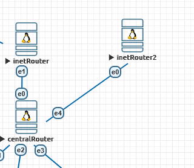

# Домашнее задание
## Сценарии iptables

🎯Задание   

1 реализовать knocking port
* centralRouter может попасть на ssh inetrRouter через knock скрипт
    пример в материалах.
  
2 добавить inetRouter2, который виден(маршрутизируется (host-only тип сети для виртуалки)) с хоста или форвардится порт через локалхост.  
3 запустить nginx на centralServer.  
4 пробросить 80й порт на inetRouter2 8080.  
5 дефолт в инет оставить через inetRouter.  


### 1 реализовать knocking port

На inetRouter прописываем правила iptables:
```
root@inetRouter:~# iptables -A INPUT -m conntrack --ctstate ESTABLISHED,RELATED -j ACCEPT
root@inetRouter:~# iptables -A INPUT -i ens4 -p tcp --dport 7777 -m recent --name KNOCK_OPEN --set -j DROP
root@inetRouter:~# iptables -A INPUT -i ens4 -p tcp --dport 22 -m recent --name KNOCK_OPEN --rcheck --seconds 15 -j ACCEPT
root@inetRouter:~# iptables -A INPUT -i ens4 -p tcp --dport 22 -j DROP
```

Проверим:
```
root@centralRouter:~# ssh root@192.168.255.1 
^C
root@centralRouter:~# ssh root@192.168.255.1 -p 7777
^C
root@centralRouter:~# ssh root@192.168.255.1 
The authenticity of host '192.168.255.1 (192.168.255.1)' can't be established.
ED25519 key fingerprint is SHA256:QJUanw2t+g+pphpEBVWRNo5+NLTMHXa9jxXMa0WwJoU.
This key is not known by any other names.
Are you sure you want to continue connecting (yes/no/[fingerprint])? yes
Warning: Permanently added '192.168.255.1' (ED25519) to the list of known hosts.
root@192.168.255.1's password: 
Welcome to Ubuntu 24.04.1 LTS (GNU/Linux 6.8.0-49-generic x86_64)

 * Documentation:  https://help.ubuntu.com
 * Management:     https://landscape.canonical.com
 * Support:        https://ubuntu.com/pro

 System information as of Tue Nov 17 06:21:17 AM UTC 2026

  System load:  0.0                Processes:             123
  Usage of /:   18.6% of 37.10GB   Users logged in:       1
  Memory usage: 12%                IPv4 address for ens3: 10.10.10.2
  Swap usage:   0%

 * Canonical Workshop gives developers fast, composable, reproducible, and
   secure developer environments that are perfect for agentic workflows.

   https://ubuntu.com/workshop

Expanded Security Maintenance for Applications is not enabled.

159 updates can be applied immediately.
3 of these updates are standard security updates.
To see these additional updates run: apt list --upgradable

Enable ESM Apps to receive additional future security updates.
See https://ubuntu.com/esm or run: sudo pro status


*** System restart required ***
Last login: Sun Nov 15 14:21:12 2026 from 172.20.1.10
root@inetRouter:~# 
```

Добавили inetrouter2:



Создадим файл knock.sh на centralRouter:
```
#!/bin/bash

# IP-адрес inetRouter во внутренней сети
TARGET_IP="192.168.255.1"
USER="root"

# Стучимся в порты (используем nmap с флагом -Pn, чтобы не тратить время на пинг)
for PORT in 7777; do
    nmap -Pn --host-timeout 100 --max-retries 0 -p $PORT $TARGET_IP > /dev/null 2>&1
    sleep 0.5
done

# Подключаемся по SSH
ssh ${USER}@${TARGET_IP}

```


Проверка через скрипт:
```
root@centralRouter:~# chmod +x knock.sh
root@centralRouter:~# ./knock.sh
root@192.168.255.1's password: 
Welcome to Ubuntu 24.04.1 LTS (GNU/Linux 6.8.0-49-generic x86_64)

 * Documentation:  https://help.ubuntu.com
 * Management:     https://landscape.canonical.com
 * Support:        https://ubuntu.com/pro

 System information as of Tue Nov 17 06:43:13 AM UTC 2026

  System load:  0.01               Processes:             119
  Usage of /:   18.6% of 37.10GB   Users logged in:       1
  Memory usage: 11%                IPv4 address for ens3: 10.10.10.2
  Swap usage:   0%

 * Canonical Workshop gives developers fast, composable, reproducible, and
   secure developer environments that are perfect for agentic workflows.

   https://ubuntu.com/workshop

Expanded Security Maintenance for Applications is not enabled.

159 updates can be applied immediately.
3 of these updates are standard security updates.
To see these additional updates run: apt list --upgradable

Enable ESM Apps to receive additional future security updates.
See https://ubuntu.com/esm or run: sudo pro status

New release '26.04.1 LTS' available.
Run 'do-release-upgrade' to upgrade to it.


*** System restart required ***
Last login: Tue Nov 17 06:41:20 2026 from 192.168.255.2
root@inetRouter:~# 
```

